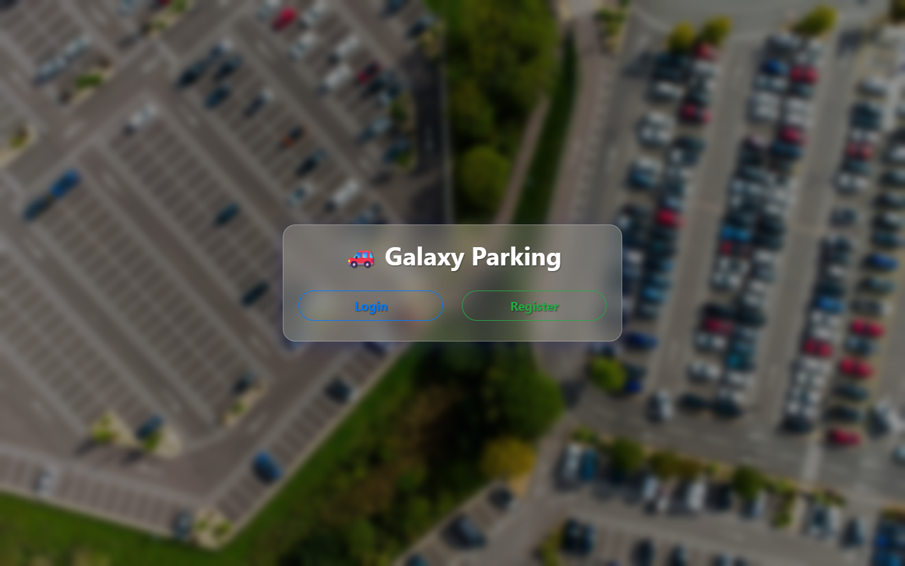
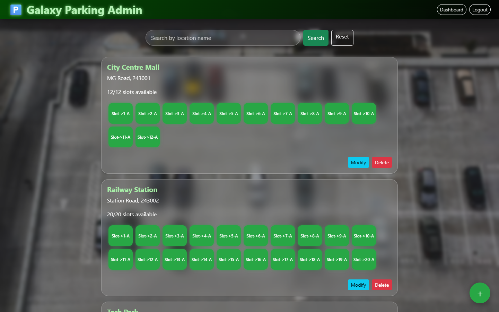
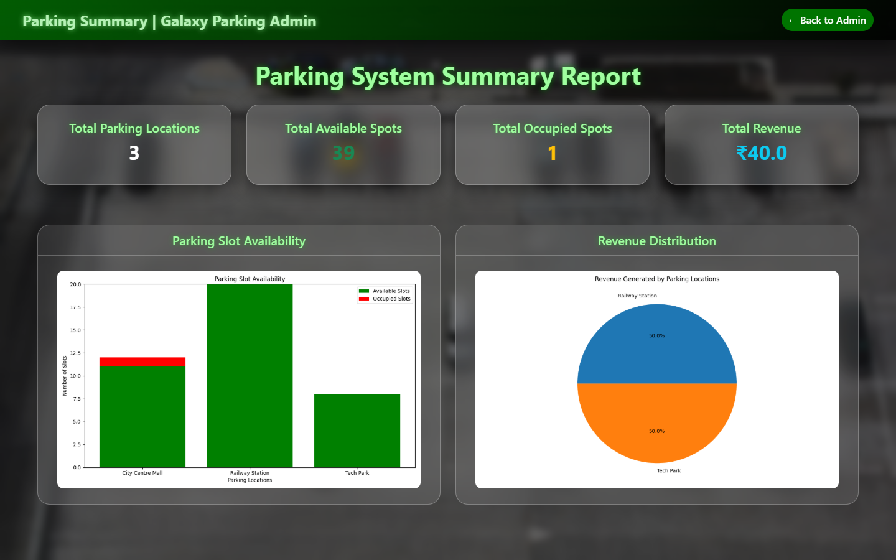
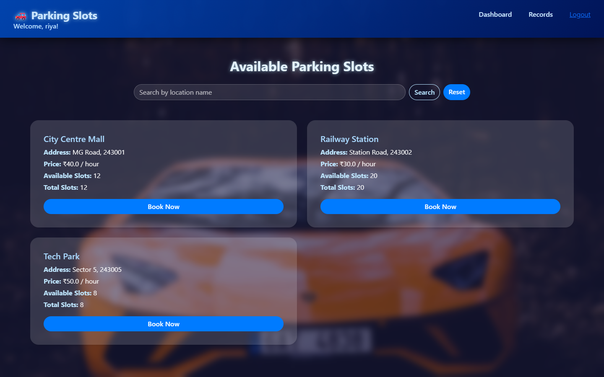
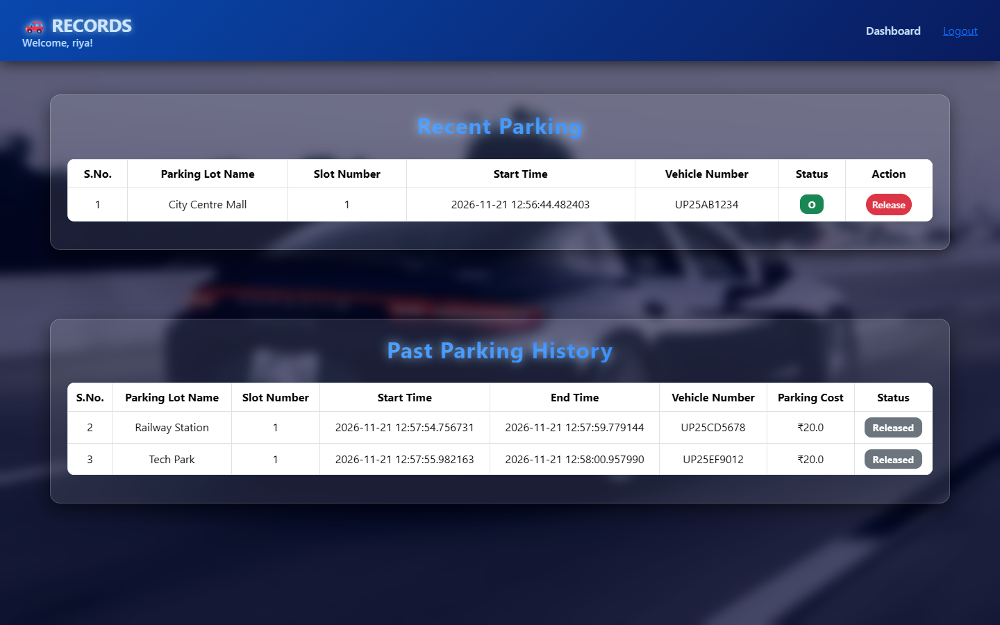
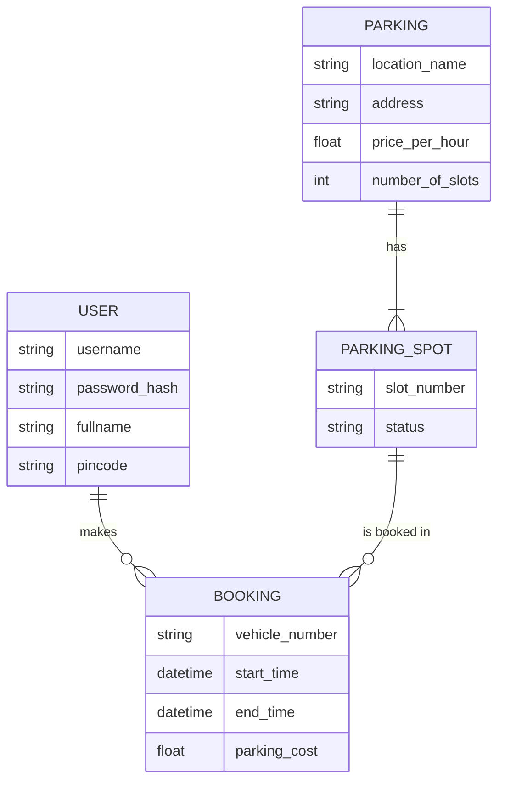

<div align="center">

# 🚗 Galaxy Parking

### Vehicle Parking Management System

A full-stack parking lot management web app where an **admin** manages lots, spots and users,
and **users** find a lot, book a spot and pay by the hour.

*Built as the Modern Application Development I (MAD-1) project of the IIT Madras BS degree.*


[](https://render.com/deploy?repo=https://github.com/HIRA04IRSHAD/vehicle-parking-app)



</div>

---

## 📸 Screenshots

| Admin: parking lots | Admin: summary report |
|---|---|
|  |  |
| **User: find a parking lot** | **User: booking history** |
|  |  |

---

## ✨ Features

<table>
<tr>
<td width="50%" valign="top">

### 🛠️ Admin
- Create, edit and delete parking lots
- Spots are generated automatically from the slot count
- See each spot's status and who is parked there
- Manage users (users with an active booking are protected)
- Summary report with slot availability and revenue charts

</td>
<td width="50%" valign="top">

### 👤 User
- Sign up, log in and edit your profile
- Search lots by name, address or pincode
- Book the first free spot (up to 3 active bookings, one per vehicle)
- Release a booking and see the cost: hourly price × time parked (minimum ₹20)
- Full booking history

</td>
</tr>
</table>

---

## 🧰 Tech Stack

| Layer | Tools |
|---|---|
| Backend | Python, Flask, Flask-SQLAlchemy, Flask-WTF (CSRF) |
| Database | SQLite locally, PostgreSQL through `DATABASE_URL` |
| Frontend | Jinja2 templates, Bootstrap, custom CSS |
| Charts | Matplotlib (rendered on the server) |
| Deployment | Gunicorn, Render blueprint (`render.yaml`) |

## 🗂️ Data Model



---

## 🚀 Run Locally

```bash
git clone https://github.com/HIRA04IRSHAD/vehicle-parking-app.git
cd vehicle-parking-app
python -m venv venv
venv\Scripts\activate          # macOS/Linux: source venv/bin/activate
pip install -r requirements.txt
copy .env.example .env         # macOS/Linux: cp .env.example .env
```

Open `.env` and set your own `SECRET_KEY` (32+ random characters) and `ADMIN_PASSWORD` (8+ characters). The app will not start without them. Then:

```bash
python app.py
```

Go to **http://127.0.0.1:5000** and log in as `admin` with the `ADMIN_PASSWORD` you set.

## ☁️ Deploy

Click **Deploy to Render** above, or in Render choose *New → Blueprint* and pick this repo. Render generates `SECRET_KEY` and `ADMIN_PASSWORD` for you; the admin password is under the service's *Environment* tab. On the free plan the SQLite data resets when the service restarts, so set `DATABASE_URL` to a PostgreSQL database if you want data to persist.

On any other host the `Procfile` runs `gunicorn app:app`. Set `SECRET_KEY`, `ADMIN_PASSWORD`, `DATABASE_URL` and `SESSION_COOKIE_SECURE=1` there.

## 🔒 Security

- Secrets come from environment variables; `.env` is never committed
- Passwords are hashed with Werkzeug
- Admin pages need the admin account, and users can only see and release their own bookings
- Every form, including delete and logout, uses POST with a CSRF token
- Sessions end automatically when a password changes or an account is deleted

> Older commits contain a hard-coded key and admin password from the first version. They are no longer used anywhere and must never be reused.

---

<div align="center">

Made by **[Hira Irshad](https://github.com/HIRA04IRSHAD)** · [LinkedIn](https://www.linkedin.com/in/hira04irshad)

</div>
